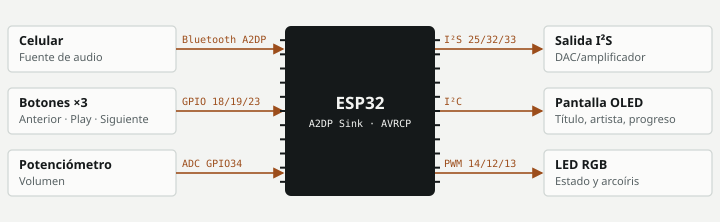

# Bocina Inteligente

Una bocina con ESP32 que recibe audio del celular por Bluetooth, lo entrega por I²S, muestra título, artista y progreso en OLED y se controla con botones y perilla.

**Estado:** Funcional · **Periodo:** jun 2026 · **Autor:** Daniel Ignacio Pedraza Martínez

## Objetivo

Reproducir música del celular con una interfaz propia y entender la ruta completa del audio en el ESP32.

## Arquitectura

El ESP32 funciona como receptor A2DP. Un callback AVRCP recibe los metadatos de la canción; el lazo principal lee botones y perilla, actualiza la OLED y el LED, y envía comandos de reproducción al celular.



## Hardware

| Componente | Función | Conexión |
|---|---|---|
| ESP32 DevKit | Receptor Bluetooth | — |
| Módulo de salida I²S | Salida de audio | `LRC 25 · BCLK 32 · DOUT 33` |
| OLED SSD1306 128×64 | Metadatos | `I²C` |
| Potenciómetro | Volumen | `GPIO34` |
| 3 botones | Control de reproducción | `GPIO 18/19/23` |
| LED RGB | Estado | `GPIO 14/12/13` |

## Firmware y protocolos

- **Audio.** Librería ESP32-A2DP como sink con pines I²S propios
- **Metadatos.** Callback AVRCP con título, artista y duración
- **Interfaz.** Marquesina de 3 px cada 350 ms para títulos de más de 14 caracteres; barra de progreso autónoma
- **Controles.** Antirrebote de 350 ms; volumen ADC 0–4095 → 0–128 aplicado solo cuando cambia

## Funcionamiento

- Se anuncia como dispositivo Bluetooth "Bocina Inteligente".
- Al cambiar de canción reinicia la barra de progreso con la duración recibida.
- Los botones envían play/pausa, siguiente y anterior al celular.

## Decisiones técnicas

- **Cambio de arquitectura en V3.** V1 consultaba Spotify y V2 reproducía radio por internet; V3 pasa a Bluetooth A2DP.
- **Barra de progreso local.** Avanza cada segundo con millis() sin depender de mensajes del celular.

## Problemas y soluciones

| Problema | Solución |
|---|---|
| Salida de audio sin DAC externo (V2) | Se configuró la salida analógica directa en el pin 25 con el DAC interno. |

## Estructura del repositorio

```
firmware/
  BocinaInteligenteV1/  Wi-Fi + Spotify en OLED
  BocinaInteligenteV2/  radio por internet (ESP32-audioI2S)
  BocinaInteligenteV3/  Bluetooth A2DP + I²S
  BocinaInteligenteV4/  controles físicos
  BocinaInteligenteV5/  versión final
docs/diagrama.svg
```

## Cómo compilar

1. Arduino IDE 2 con el paquete **esp32 de Espressif** (placa *ESP32 Dev Module*).
2. Instala las librerías listadas abajo desde el gestor de librerías.
3. Si la carpeta del sketch tiene `secrets.example.h`, cópialo como `secrets.h` y llena tus datos.
4. Abre el `.ino` de la versión que quieras y súbelo.

**Librerías:** ESP32-A2DP (pschatzmann), Adafruit SSD1306, Adafruit GFX; V1: ArduinoJson y SpotifyArduino; V2: ESP32-audioI2S

## Evolución

- **V1:** Wi-Fi + Spotify: muestra la canción en OLED.
- **V2:** Radio por internet con ESP32-audioI2S y DAC interno.
- **V3:** Bluetooth A2DP Sink con salida I²S.
- **V4–V5:** Botones, perilla, LED arcoíris, marquesina y barra autónoma.

## Limitaciones

- Sin control de volumen por AVRCP desde el celular documentado.

## Mejoras futuras

- Documentar la cadena de audio y medir calidad o latencia.
- Carcasa y alimentación por batería.

---
Parte del [portafolio técnico](https://github.com/nshtpdrz) de Daniel Ignacio Pedraza Martínez · Ingeniería en Tecnologías de la Información y Comunicaciones, Tecnológico Nacional de México, Campus Pachuca.
